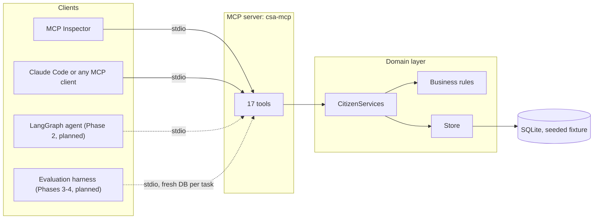

# Citizen Service Workflow Agent

[](https://github.com/lamebrowndev/citizen-service-workflow-agent/actions/workflows/ci.yml)

**An AI agent for municipal citizen services, built on a deterministic backend so its reliability can be measured instead of asserted.**

A citizen writes: *"I just moved. Can I get a parking permit for my car?"* Behind that sentence is a workflow with rules and money attached: verify identity, check eligibility, quote the fee, take payment, submit the application. An AI agent can run that workflow, but only if it calls the right tools, in the right order, with the right arguments, and never charges anyone twice.

This repository builds that system in five phases. **Phase 1 is complete:** a deterministic backend for the fictional city of **Civitas**, exposed as a **Model Context Protocol (MCP) server with 17 tools**. Later phases add the agent, an evaluation harness, a single-agent versus multi-agent comparison, and an HTTP API.

> **Status:** Phase 1 of 5 complete. No agent performance numbers appear here yet, because none have been measured yet.

> **Disclaimer:** Civitas is a fictional city. All people, addresses, vehicles, and records are synthetic. This project is not affiliated with any government or public agency.

## Contents

- [Why this project exists](#why-this-project-exists)
- [What is built so far](#what-is-built-so-far)
- [Architecture](#architecture)
- [Quickstart](#quickstart)
- [Try it in two minutes](#try-it-in-two-minutes)
- [The 17 tools](#the-17-tools)
- [Engineering highlights](#engineering-highlights)
- [Roadmap](#roadmap)
- [Documentation](#documentation)
- [Development](#development)

## Why this project exists

LLM agents are increasingly placed in front of real workflows, yet claims about their reliability rarely come with evidence anyone can reproduce. This project asks two concrete questions and builds the machinery to answer them honestly:

1. **How accurately does an agent use tools** on realistic, multi-step government-service workflows: the right tool, with the right arguments, in the right order?
2. **Does a multi-agent design actually help**, or does it add cost and latency for the same success rate?

Answering either question requires a backend that behaves identically on every run, so that differences in results come from the agent and not from the environment. That is why the backend was built first. The full reasoning is in the [project guide](docs/project-guide.md).

## What is built so far

- **17 MCP tools** for identity verification, parking permits, birth-certificate copies, bulk-waste pickups, address changes, street-issue reports, office appointments, case status, and human escalation.
- **Deterministic by construction:** a simulated clock, content-derived IDs, and a seeded fixture. The same calls on the same seed produce identical database state.
- **Safe to retry:** every write tool is idempotent. Repeating a call returns the original record (`created: false`) instead of charging or booking twice.
- **Server-enforced authorization:** citizen-scoped tools require an HMAC-signed token that only `verify_citizen` can issue, so an agent cannot act for someone it has not verified.
- **Typed and tested:** `mypy --strict`, `ruff`, more than 200 tests including an end-to-end test against the real server process, and CI on every push.

## Architecture



Solid lines exist today; dashed lines are planned. Details are in the [Architecture section of the guide](docs/project-guide.md#4-architecture).

## Quickstart

Requirements: Python 3.13 and [uv](https://docs.astral.sh/uv/). Docker is not needed.

```bash
git clone https://github.com/lamebrowndev/citizen-service-workflow-agent.git
cd citizen-service-workflow-agent
make setup    # create .venv and install dependencies
make seed     # build var/citizen.db from the bundled fixture
make check    # format check, lint, strict type check, tests
make mcp      # run the MCP server on stdio
```

## Try it in two minutes

Run `make seed && make inspector`. The MCP Inspector opens in your browser; click **Connect**, open the **Tools** tab, and call these tools in order:

| Step | Tool | Arguments | Result |
| --- | --- | --- | --- |
| 1 | `verify_citizen` | `full_name: "Amara Okafor"`, `date_of_birth: "1961-03-02"`, `postal_code: "CV-101"` | `citizen_token: "CTK.CIT-0001.C3D580D6ACEC6E3F"` |
| 2 | `check_eligibility` | the token, `service_type: "PARKING_PERMIT"` | `eligible: true` |
| 3 | `quote_fee` | the token, `service_type: "PARKING_PERMIT"` | `quote_id: "QTE-3DA94D2B"`, `amount_cents: 3000` (the senior rate: Amara turns 65 on the simulated date) |
| 4 | `pay_quote` | the token, `quote_id: "QTE-3DA94D2B"` | `payment_id: "PAY-0ECB7B2E"`, `status: "PAID"` |
| 5 | `apply_parking_permit` | the token, `license_plate: "CVX1234"`, `payment_id: "PAY-0ECB7B2E"` | `application_id: "APP-8378276D"`, `status: "SUBMITTED"`, `created: true` |
| 6 | Repeat step 5 | the same arguments | the same `APP-8378276D` with `created: false`: no duplicate |

The backend is deterministic, so you get exactly these values (the token depends on the default development secret). Run `make seed` again to reset the city.

To use the tools from Claude Code instead:

```bash
claude mcp add civitas -- uv --directory /path/to/citizen-service-workflow-agent run csa-mcp
```

## The 17 tools

| Tool | Type | Token | Purpose |
| --- | --- | --- | --- |
| `verify_citizen` | Read | No | Match name, date of birth, and postal code; return a signed citizen token |
| `get_citizen_profile` | Read | Yes | Address, zone, vehicles, applications, booked appointments, scheduled pickups |
| `update_address` | Write | Yes | Change the registered street address and postal code |
| `get_service_info` | Read | No | Requirements, fee rules, and processing time of a service |
| `check_eligibility` | Read | Yes | Whether the citizen qualifies for a service, with every reason if not |
| `quote_fee` | Write | Yes | Create a fee quote for a paid service, or return the open one |
| `pay_quote` | Write | Yes | Charge the simulated card on file for a quote, exactly once |
| `apply_parking_permit` | Write | Yes | Submit a parking permit application funded by a payment |
| `request_birth_certificate` | Write | Yes | Request 1 to 5 certified birth certificate copies funded by a payment |
| `list_pickup_dates` | Read | Yes | Next four bulk-waste pickup dates for the citizen's zone |
| `schedule_bulk_pickup` | Write | Yes | Schedule one pickup of up to five items on an offered date |
| `report_street_issue` | Write | No | Report a pothole, streetlight fault, graffiti, or missed collection |
| `get_case_status` | Read | For applications | Status of an application or a street issue |
| `list_appointment_slots` | Read | No | Free 30-minute slots at an office on a date |
| `book_appointment` | Write | Yes | Book a free slot |
| `cancel_appointment` | Write | Yes | Cancel a booked appointment and free the slot |
| `escalate_to_human` | Write | Optional | Hand the request to a human staff member |

Arguments, results, errors, retry behavior, and real examples for each tool: [Tool reference](docs/tool-reference.md).

## Engineering highlights

- **The environment is the ground truth.** The same seed and the same calls produce the same IDs and the same database, which is what will make evaluation scores reproducible.
- **Idempotency done carefully.** Retries return the original record, and replays match only live records, so a repeat order is a new order while a retried payment is never a second charge.
- **Authorization lives in the server, not the prompt.** Signed tokens, ownership checks on every lookup, and `NOT_FOUND` for other citizens' records so that existence never leaks.
- **Errors an agent can act on.** Sixteen stable error codes, such as `NOT_ELIGIBLE` and `SLOT_UNAVAILABLE`, delivered through MCP's `isError` channel.
- **One transaction per call.** Any failure rolls back, so a failed call leaves no partial state.
- **Packaging verified in CI.** The pipeline builds the wheel and fails if the fixture or the schema is missing from it.

## Roadmap

| Phase | Deliverable | Status |
| --- | --- | --- |
| 1 | Deterministic domain backend and MCP server (17 tools), tests, CI | Done |
| 2 | Single LangGraph agent using Claude through the Anthropic SDK, connected over MCP; command-line chat | Planned |
| 3 | Evaluation harness and dataset (30 development tasks, 150 held-out test tasks); metrics report | Planned |
| 4 | Multi-agent variant and a pre-registered single versus multi-agent comparison | Planned |
| 5 | FastAPI service with human approval before payments; results write-up | Planned |

## Documentation

- [Project guide](docs/project-guide.md): the problem, motivation, architecture, how every part works, each design decision and its reasons, security, testing, the evaluation plan, FAQ, and glossary.
- [Tool reference](docs/tool-reference.md): all 17 tools with arguments, results, errors, retry behavior, and examples.

## Development

| Command | What it does |
| --- | --- |
| `make setup` | Create `.venv` and install runtime and development dependencies with uv |
| `make seed` | Rebuild `var/citizen.db` from the bundled fixture |
| `make mcp` | Run the server on stdio |
| `make mcp-http` | Run the server on Streamable HTTP at `http://127.0.0.1:8765/mcp` |
| `make inspector` | Open the MCP Inspector connected to the server |
| `make fmt` | Format the code with ruff |
| `make check` | Format check, lint, `mypy --strict`, and tests (what CI runs) |

Configuration comes from environment variables (see `.env.example`):

| Variable | Default | Meaning |
| --- | --- | --- |
| `CSA_DB_PATH` | `var/citizen.db` | SQLite database path, resolved to an absolute path |
| `CSA_TOKEN_SECRET` | `civitas-dev-secret` | HMAC secret for citizen tokens; a warning is logged when the default is used |
| `CSA_LOG_LEVEL` | `INFO` | Log level; logs go to stderr only |

## License

MIT. See [LICENSE](LICENSE).
