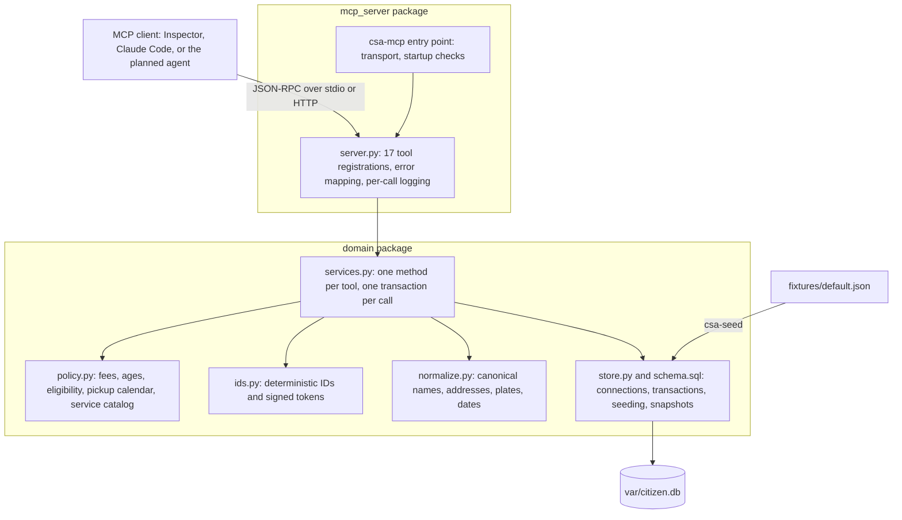
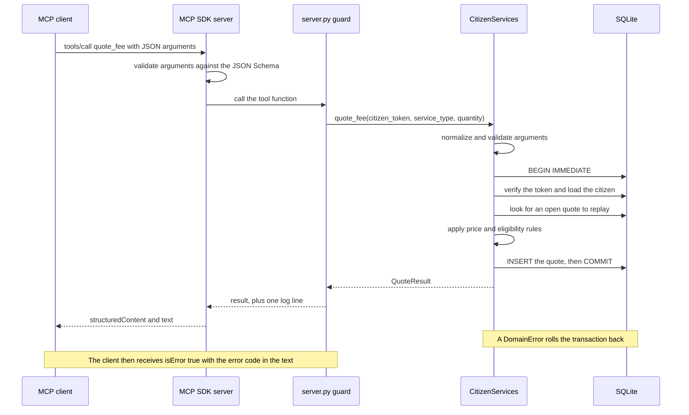
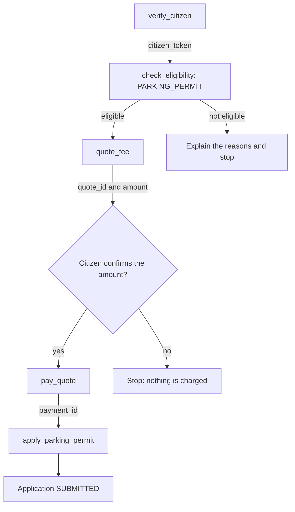
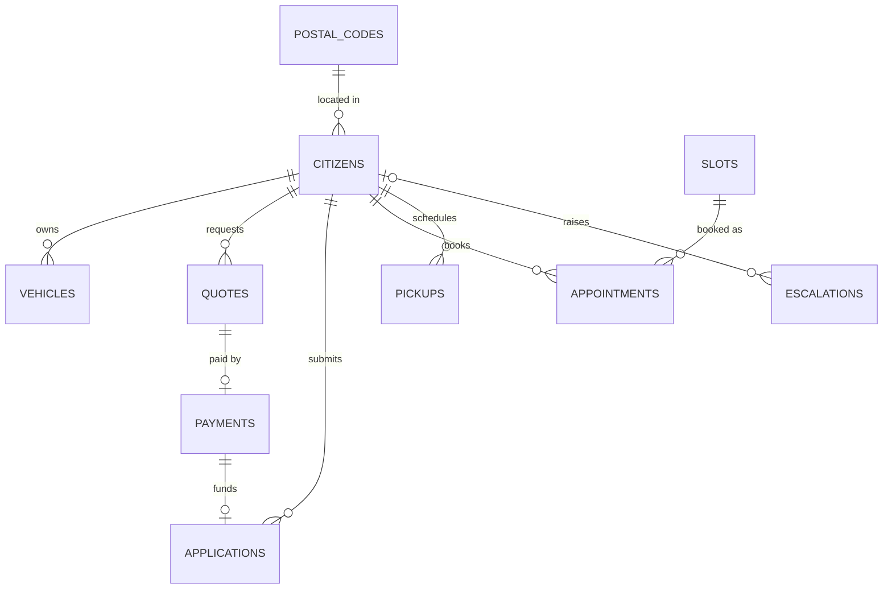

# Project Guide

This guide explains the Citizen Service Workflow Agent from first principles: the problem it addresses, why it exists, how it is built, how every part works, and why each decision was made. Read it once, top to bottom, and you should be able to explain any part of the system. Per-tool details live in the [Tool reference](tool-reference.md).

> **Status:** Phase 1 of 5 is complete: the deterministic backend and MCP server. Everything about Phases 2 to 5 describes plans and is labeled as such. No agent performance results exist yet.

## Contents

1. [The problem](#1-the-problem)
2. [Goals and non-goals](#2-goals-and-non-goals)
3. [The approach in five phases](#3-the-approach-in-five-phases)
4. [Architecture](#4-architecture)
5. [The simulated city of Civitas](#5-the-simulated-city-of-civitas)
6. [How a tool call works, end to end](#6-how-a-tool-call-works-end-to-end)
7. [A complete workflow, step by step](#7-a-complete-workflow-step-by-step)
8. [Determinism](#8-determinism)
9. [Idempotency and safe retries](#9-idempotency-and-safe-retries)
10. [Security and privacy](#10-security-and-privacy)
11. [Error codes](#11-error-codes)
12. [Data model](#12-data-model)
13. [The fixture](#13-the-fixture)
14. [Technology choices](#14-technology-choices)
15. [Design decisions](#15-design-decisions)
16. [Testing and quality](#16-testing-and-quality)
17. [Defects found during implementation and review](#17-defects-found-during-implementation-and-review)
18. [Evaluation plan](#18-evaluation-plan)
19. [Limitations](#19-limitations)
20. [Repository map](#20-repository-map)
21. [Running and connecting](#21-running-and-connecting)
22. [FAQ](#22-faq)
23. [Glossary](#23-glossary)

## 1. The problem

### Citizen services are workflows, not questions

A request such as "I need a parking permit" is not answered by looking something up. It is a sequence of dependent actions, each governed by rules:

1. **Identity.** Who is asking?
2. **Eligibility.** Do they live in a permit area, own a registered vehicle, and not already hold a permit?
3. **Price.** What does it cost for this person? Residents aged 65 or older pay half.
4. **Consent.** Has the citizen agreed to pay that amount?
5. **Payment, then submission.** In that order, exactly once.

### Agents fit this shape, and fail in costly ways

A language model with tools can read a free-form request and chain these steps. It can also fail in specific, expensive ways:

| Agent failure | What it costs in citizen services |
| --- | --- |
| Calls the wrong tool | Applies for the wrong service |
| Passes a wrong argument (date format, plate, postal code) | The request is rejected, or applied to the wrong record |
| Skips a step, such as the eligibility check | The citizen pays for a service they cannot receive |
| Acts before verifying identity | One citizen's data is exposed to another |
| Retries a payment | The citizen is charged twice |

### The deeper problem is measurement

Agent demos show a happy path. They rarely answer how often the agent calls the right tool with the right arguments, under what definition, on which tasks, and whether the same number would come out again tomorrow. Without a reproducible environment, an accuracy figure is an anecdote.

### The question this project answers

Can a tool-using agent for government-service workflows be measured reproducibly, and can that measurement drive an architecture decision, single agent or multi-agent, on evidence rather than fashion?

### Why government services

The domain combines everything that makes agent evaluation meaningful: multi-step workflows with ordering constraints, explicit rules with edge cases (age boundaries, zones, quotas), money, identity, and privacy. Failures are concrete and checkable, which is exactly what an evaluation needs. A fictional city keeps all data synthetic and implies no affiliation with any real government.

## 2. Goals and non-goals

**Goals**

1. Realistic multi-step workflows with real rules: eligibility, fees, scheduling, and authorization.
2. A deterministic backend: identical inputs produce identical outputs and an identical database.
3. Safety enforced by the server rather than by prompt instructions: authorization, idempotency, no double charges.
4. A reproducible evaluation of tool-call accuracy and task success on held-out tasks (Phase 3).
5. An evidence-based choice between single-agent and multi-agent designs (Phase 4).
6. Production-grade hygiene: typed code, tests, CI, and documented decisions.

**Non-goals**

- Integration with any real government system or payment provider.
- Real identity proofing; the token scheme is a prototype (see [Limitations](#19-limitations)).
- A polished end-user interface.
- Multi-node scale or high-throughput performance.

## 3. The approach in five phases

| Phase | Deliverable | Why it comes at this point | Status |
| --- | --- | --- | --- |
| 1 | Deterministic domain backend and MCP server | The evaluation needs a stable ground truth before any agent is measured against it | Done |
| 2 | Single agent: LangGraph with Claude, tools over MCP | The simplest agent that can complete the workflows; it becomes the baseline | Planned |
| 3 | Evaluation harness and dataset | Measure the baseline; tune prompts on the development set only | Planned |
| 4 | Multi-agent variant and comparison | Same tools, tasks, and model, so only the architecture differs | Planned |
| 5 | FastAPI service with human approval before payments | Make it usable as a service, with a human in the loop for money | Planned |

The guiding principle: build the thing you measure against first, and make it boring and predictable.

## 4. Architecture



| Layer | Files | Responsibility |
| --- | --- | --- |
| Entry point | `mcp_server/__main__.py` | The `csa-mcp` command: chooses the transport, refuses to start if the database is missing (exit code 2), configures stderr logging |
| Protocol adapter | `mcp_server/server.py` | Registers the 17 tools with schemas and annotations, converts domain errors into MCP tool errors, logs one line per call |
| Services | `domain/services.py` | One method per tool; runs the workflow logic inside a single transaction |
| Policy | `domain/policy.py` | Pure business rules: fees, ages, eligibility, pickup calendar, service catalog |
| Identity | `domain/ids.py` | Deterministic record IDs and signed citizen tokens |
| Normalization | `domain/normalize.py` | Canonical forms for names, addresses, plates, postal codes, dates, IDs, and free text |
| Storage | `domain/store.py`, `domain/schema.sql` | Connections, transactions, seeding from the fixture, snapshots |
| Data | `fixtures/default.json` | The seeded city |

**Dependency rule.** `mcp_server` depends on `domain`; `domain` never imports MCP. The same `CitizenServices` object serves MCP today and can be called directly by tests, by the planned evaluation harness, or by a future HTTP API.

**Transports**

| Transport | How it works | Used by |
| --- | --- | --- |
| stdio (default) | The client starts `csa-mcp` as a subprocess and exchanges JSON-RPC messages over stdin and stdout | MCP Inspector, Claude Code, the planned agent and evaluator |
| Streamable HTTP | `make mcp-http` serves `http://127.0.0.1:8765/mcp`, bound to localhost by default | Network clients and the planned HTTP API |

Because stdout carries the protocol in stdio mode, the server never prints to stdout. All logs go to stderr.

**Planned additions:** `agents/` (Phases 2 and 4), `evaluation/` plus an `evals/` data folder (Phase 3), and `api/` (Phase 5).

## 5. The simulated city of Civitas

Civitas is a small fictional city whose entire state lives in one SQLite database, seeded from `src/citizen_agent/fixtures/default.json`. The simulated date is **Monday, 2026-03-02**.

**Geography**

| Postal codes | Zone | Bulk pickup day | In the parking permit area |
| --- | --- | --- | --- |
| CV-101, CV-102 | NORTH | Tuesday | CV-101 only |
| CV-103, CV-104 | SOUTH | Wednesday | CV-103 only |
| CV-105, CV-106 | EAST | Thursday | CV-105 only |
| CV-107, CV-108 | WEST | Friday | CV-107 only |

**Population**

- 40 citizens (`CIT-0001` to `CIT-0040`) and 37 registered vehicles.
- 18 existing applications and 12 street-issue reports, covering every status.
- 120 appointment slots: 2 offices × 10 business days × 6 half-hour slots from 09:00 to 11:30.
- 33 existing appointments (30 booked, 3 cancelled) and 5 bulk pickups (2 scheduled, 3 completed).

**Services**

| Service | What it is | Fee | Rules |
| --- | --- | --- | --- |
| `PARKING_PERMIT` | Annual residential parking permit | $60.00, or $30.00 for residents aged 65+ | Permit-area postal code, at least one registered vehicle, no active permit |
| `BIRTH_CERTIFICATE_COPY` | Certified copy of your own birth certificate | $15.00 per copy, 1 to 5 copies | Birth registered in Civitas |
| `BULK_WASTE_PICKUP` | Curbside pickup of up to 5 items | Free | One scheduled pickup at a time, on one of the next four zone pickup days |
| `ADDRESS_CHANGE` | Update the registered address | Free | The new postal code must be a Civitas code |
| `STREET_ISSUE_REPORT` | Pothole, streetlight, graffiti, or missed collection | Free | No identity needed |
| `OFFICE_APPOINTMENT` | 30-minute in-person appointment | Free | CITY_HALL or NORTH_BRANCH; the slot must be free |

**Rules worth knowing**

- **Senior:** aged 65 or older on the simulated date. Age is the difference in years, minus one if this year's birthday has not happened yet. People born on 29 February are handled correctly.
- **Eligibility reasons** are all returned, in a fixed order: `NOT_IN_PERMIT_AREA`, `NO_REGISTERED_VEHICLE`, `ACTIVE_PERMIT_EXISTS` (a parking application that is submitted, in review, or approved), `NO_BIRTH_RECORD`, `PICKUP_ALREADY_SCHEDULED`.
- **Pickup dates** are the next four zone pickup days strictly after the simulated date.
- **Money** is stored as integer cents (USD) to avoid floating-point rounding.

## 6. How a tool call works, end to end



Step by step, using `quote_fee`:

1. The client sends a `tools/call` request with the tool name and JSON arguments.
2. The MCP SDK validates the arguments against the tool's JSON Schema, which is generated from the Python type hints. Invalid arguments are rejected before any project code runs; the server log records only the names of the rejected fields, never their values.
3. The guard in `server.py` starts a timer and calls the service method.
4. The service normalizes its arguments (for example `cvx-1234` becomes `CVX1234`) and rejects malformed input with `INVALID_ARGUMENT` before touching the database.
5. It opens a fresh connection and starts a transaction: `BEGIN IMMEDIATE` for writes, plain `BEGIN` for reads.
6. It verifies the citizen token (HMAC signature, constant-time comparison) and loads the citizen.
7. It checks ownership of any record the call refers to.
8. It computes the deterministic ID of the record it would create. If a live record with that ID exists, it returns that record with `created: false` (a replay).
9. Otherwise it applies the business rules from `policy.py`.
10. It inserts, commits, and returns a Pydantic model.
11. The SDK sends the result as `structuredContent` (a JSON object) and as text. The guard logs `tool=quote_fee outcome=ok duration_ms=...` to stderr.

**What the client receives on success:**

```json
{"quote_id": "QTE-3DA94D2B", "service_type": "PARKING_PERMIT", "quantity": 1, "amount_cents": 3000, "currency": "USD", "created": true}
```

**What the client receives on failure:** a result with `isError: true` and text such as:

```text
Error executing tool quote_fee: NO_FEE_REQUIRED: This service does not require a fee.
```

The `Error executing tool <name>:` prefix is added by the MCP SDK; the code after it comes from the domain. An unexpected exception never leaks internals: the client sees `INTERNAL_ERROR: unexpected server error`, and the traceback goes only to the server log.

## 7. A complete workflow, step by step

The parking permit is the richest workflow: five tools, a payment, and a consent point.



A real run on a freshly seeded database (default development secret):

```text
verify_citizen("Amara Okafor", "1961-03-02", "CV-101")
  -> {"citizen_token": "CTK.CIT-0001.C3D580D6ACEC6E3F", "full_name": "Amara Okafor"}
check_eligibility(token, "PARKING_PERMIT")
  -> {"service_type": "PARKING_PERMIT", "eligible": true, "reasons": []}
quote_fee(token, "PARKING_PERMIT")
  -> {"quote_id": "QTE-3DA94D2B", "service_type": "PARKING_PERMIT", "quantity": 1, "amount_cents": 3000, "currency": "USD", "created": true}
pay_quote(token, "QTE-3DA94D2B")
  -> {"payment_id": "PAY-0ECB7B2E", "quote_id": "QTE-3DA94D2B", "amount_cents": 3000, "status": "PAID", "created": true}
apply_parking_permit(token, "cvx-1234", "PAY-0ECB7B2E")
  -> {"application_id": "APP-8378276D", "service_type": "PARKING_PERMIT", "status": "SUBMITTED", "created": true}
apply_parking_permit(token, "CVX1234", "PAY-0ECB7B2E")        (a retry)
  -> {"application_id": "APP-8378276D", "service_type": "PARKING_PERMIT", "status": "SUBMITTED", "created": false}
```

What this shows:

- The fee is 3000 cents ($30.00), the senior rate. Amara was born on 1961-03-02 and turns 65 on the simulated date, exactly at the boundary.
- The plate was typed as `cvx-1234` and normalized to `CVX1234`, the plate registered to Amara.
- The retry returned the same application with `created: false`. Nothing new was written, and nothing was charged twice.

**When things go wrong**

| Call | Result |
| --- | --- |
| `check_eligibility` for Hiroshi Tanaka (`CIT-0006`, postal code CV-106) | `eligible: false`, `reasons: ["NOT_IN_PERMIT_AREA"]` |
| `verify_citizen` with the wrong date of birth | `VERIFICATION_FAILED: Identity verification failed.` (it does not say which field) |
| `get_citizen_profile` with a forged token | `INVALID_TOKEN: Citizen token is invalid.` |
| `quote_fee` for `ADDRESS_CHANGE` | `NO_FEE_REQUIRED: This service does not require a fee.` |
| `get_case_status("APP-8378276D")` without a token | `AUTH_REQUIRED: A citizen token is required for applications.` |

### Canonical workflows

These are the intended tool sequences for common requests. Phase 2 will encode them in the agent's standard operating procedures (SOPs), and Phase 3 will use them as the correct ("gold") answers.

| Request | Tool sequence | Calls |
| --- | --- | --- |
| Parking permit | `verify_citizen`, `check_eligibility`, `quote_fee`, `pay_quote`, `apply_parking_permit` | 5 |
| Birth certificate copies | `verify_citizen`, `check_eligibility`, `quote_fee` (quantity = copies), `pay_quote`, `request_birth_certificate` | 5 |
| Change of address | `verify_citizen`, `update_address` | 2 |
| Bulk-waste pickup | `verify_citizen`, `check_eligibility`, `list_pickup_dates`, `schedule_bulk_pickup` | 4 |
| Report a pothole | `report_street_issue` | 1 |
| Status of an application | `verify_citizen`, `get_case_status` (with the token) | 2 |
| Status of a street issue | `get_case_status` | 1 |
| Book an appointment | `verify_citizen`, `list_appointment_slots`, `book_appointment` | 3 |
| Reschedule an appointment | `verify_citizen`, `get_citizen_profile`, `list_appointment_slots`, `book_appointment`, `cancel_appointment` | 5 |
| Moved, and needs a new permit | `verify_citizen`, `update_address`, `check_eligibility`, `quote_fee`, `pay_quote`, `apply_parking_permit` | 6 |
| Out of scope, or asks for a person | `escalate_to_human` | 1 |

Two details matter. A reschedule books the new slot before cancelling the old one, so a failed booking never loses the existing appointment. A payment is made only after the citizen explicitly confirms the quoted amount.

## 8. Determinism

Running the same calls against the same seed must produce the same results and the same database, every time. Three common sources of variation are removed:

| Source of variation | Typical code | What this project does instead |
| --- | --- | --- |
| The wall clock | `date.today()` | "Today" is stored in the database (`meta.today`); ruff's DTZ rules flag naive date and time calls |
| Random identifiers | `uuid4()` | IDs are hashes of what the record is (see below) |
| Shared, drifting data | One long-lived database | Every test, and every planned evaluation task, starts from a fresh copy seeded from the committed fixture |

**How IDs are built.** An ID is a prefix, a hyphen, and the first 8 hexadecimal characters (uppercase) of the SHA-256 hash of the record's key parts joined with `|`. Key parts are normalized first, so `cvx-1234` and `CVX 1234` produce the same key.

| Record | Prefix | Key parts |
| --- | --- | --- |
| Quote | `QTE` | Citizen, service, quantity, and how many quotes already exist for that combination |
| Payment | `PAY` | Quote ID |
| Application | `APP` | Citizen, service, payment ID |
| Appointment | `APT` | Citizen, slot ID |
| Bulk pickup | `PKP` | Citizen, date |
| Street issue | `ISS` | Category, normalized address, date reported |
| Escalation | `ESC` | Citizen and date; for anonymous escalations, date and normalized summary |
| Appointment slot | `SLOT` | Readable rather than hashed, for example `SLOT-CITY_HALL-20260305-0930` |

Applications that already exist in the fixture carry fixed IDs, such as `APP-1A2B3C4D`.

An insert never overwrites an existing row. If two different records ever produced the same ID, the insert fails, the error is logged, and the transaction rolls back.

**Proof.** Tests seed two databases and compare their full snapshots, and run the same multi-order sequence on two fresh databases and compare those too.

**Why it matters.** In Phase 3, task success will be judged by comparing the database after the agent's run with the database after replaying the correct sequence of calls. That comparison only means something if the backend is deterministic.

## 9. Idempotency and safe retries

Agents retry. A model may re-plan and repeat a step, misread a result, or time out after the server has already committed. Without protection, every retry is a duplicate charge or a duplicate booking.

Every write tool computes the ID of the record it would create. If a **live** record with that ID already exists, the tool returns it with `created: false` (or `changed: false`) and writes nothing. That is a replay.

The word "live" matters: a retry must replay, but a genuinely new request that happens to look the same must not.

| Tool | Replays when | Otherwise |
| --- | --- | --- |
| `quote_fee` | The citizen has an open quote for the same service and quantity: not yet used by an application, even if already paid | Creates a new quote with the next sequence number |
| `pay_quote` | A payment for that quote exists | Re-checks eligibility, then charges |
| `apply_parking_permit` | An application already uses that payment with the same plate | A different plate gives `PAYMENT_ALREADY_USED` |
| `request_birth_certificate` | An application already uses that payment with the same number of copies | Different copies give `PAYMENT_ALREADY_USED` |
| `schedule_bulk_pickup` | A scheduled pickup exists on that date with the same item count | A different count gives `ALREADY_SCHEDULED`; completed pickups are never replayed |
| `book_appointment` | The citizen already holds that slot | A slot the citizen cancelled earlier is booked again |
| `report_street_issue` | The same category at the same address was already reported today | Creates a new issue |
| `escalate_to_human` | The same citizen already escalated today, or the same anonymous summary was already sent today | Creates a new escalation |
| `update_address`, `cancel_appointment` | Naturally idempotent: repeating returns `changed: false` | Applies the change |

**Worked example: a payment survives a failed application.** A citizen gets a parking quote and pays. Before applying, they move to a postal code outside the permit area, so `apply_parking_permit` fails with `NOT_ELIGIBLE` and rolls back. They move back. Asking for a quote again returns the same open quote, paying again returns the same payment without a new charge, and the application succeeds with the original payment. One charge, one permit.

## 10. Security and privacy

The agent is treated as untrusted: it may hallucinate an ID, follow an injected instruction, or retry blindly. The server therefore enforces the rules itself.

| Threat | Mitigation |
| --- | --- |
| The agent acts for someone it has not verified, through a hallucinated or injected citizen ID | Citizen-scoped tools accept only a signed `citizen_token`, never a citizen ID; only `verify_citizen` issues tokens |
| A forged or altered token | The HMAC-SHA256 signature is checked with a constant-time comparison, and the citizen must exist |
| Reading or changing another citizen's records | Every lookup is filtered by the token's citizen |
| Learning whether a record exists | Missing records and other citizens' records both return `NOT_FOUND`; `VERIFICATION_FAILED` never names the mismatched field |
| A retry returning someone else's data | Ownership is checked before looking for a replay |
| Charging someone who cannot receive the service | `quote_fee` and `pay_quote` both enforce eligibility; applications re-check it |
| Double charges | Payments are idempotent per quote; the database allows one payment per quote and one application per payment |
| Card data exposure | No tool accepts card details; payment uses a simulated card on file |
| Personal data in logs | INFO logs record only tool, outcome, and duration; arguments appear only at DEBUG; rejected arguments are logged by field name, not value; no tool returns a date of birth |
| Exposure on the network | The HTTP transport binds to 127.0.0.1 by default |
| Leaking internals | Unexpected errors reach the client only as `INTERNAL_ERROR: unexpected server error`; the traceback stays in the server log |

The `pay_quote` description instructs the agent to call it only after the citizen explicitly confirms the amount. Phase 5 adds human approval before any payment.

**Token format.** `CTK.<citizen_id>.<signature>`, where the signature is the first 16 hexadecimal characters of HMAC-SHA256 over the citizen ID with the server secret. The citizen ID is visible inside the token; what cannot be produced without the secret is the signature. Example with the default development secret: `CTK.CIT-0001.C3D580D6ACEC6E3F`.

**Known limitations.** Tokens do not expire and are not bound to a session. The development secret is public, and a warning is logged when it is used. Verification attempts are not rate-limited. Identity proofing is three matching fields. A production system would issue short-lived, session-bound tokens from a real identity provider and rate-limit verification.

## 11. Error codes

Every expected failure has a stable code. Messages are short and never contain another citizen's data.

| Code | Meaning | What an agent should do |
| --- | --- | --- |
| `INVALID_ARGUMENT` | Malformed input: a date not in `YYYY-MM-DD` form, a bad plate, blank text | Fix the format and retry |
| `INVALID_TOKEN` | The token is malformed, forged, or names an unknown citizen | Verify the citizen again |
| `AUTH_REQUIRED` | An application status was requested without a token | Verify, then retry with the token |
| `VERIFICATION_FAILED` | Name, date of birth, and postal code do not match one citizen | Ask the citizen to check their details; never guess |
| `NOT_FOUND` | The record does not exist or belongs to someone else | Check the ID; do not speculate about other people's records |
| `NOT_ELIGIBLE` | Service rules not met; the message lists the reason codes | Explain the reasons |
| `INVALID_POSTAL_CODE` | Not a Civitas postal code | Ask for the correct code |
| `NO_FEE_REQUIRED` | A quote was requested for a free service | Skip quoting and payment |
| `INVALID_QUANTITY` | Copies or items out of range, or a parking quantity other than 1 | Correct the quantity |
| `PAYMENT_INVALID` | The payment is for a different service or quantity | Use the matching payment |
| `PAYMENT_ALREADY_USED` | The payment already funds a different application | Do not reuse it; start a new quote |
| `PLATE_NOT_REGISTERED` | The plate is not registered to this citizen | Ask for the right plate (the profile lists vehicles) |
| `SLOT_UNAVAILABLE` | Someone else booked the slot | List slots again |
| `DATE_UNAVAILABLE` | Not one of the offered pickup dates | List pickup dates again |
| `ALREADY_SCHEDULED` | The citizen already has a scheduled pickup | Tell the citizen |
| `INTERNAL_ERROR` | A server bug or integrity failure | Escalate to a human |

To extract the code from an error result, match the pattern `\b([A-Z][A-Z_]+): ` against the text; this skips the SDK's prefix.

## 12. Data model



There are 12 tables. The ones not shown above: `meta` holds `today` and `fixture_name`; `issues` stands alone because street issues are anonymous.

Constraints enforce rules in the database itself:

- Foreign keys are switched on for every connection.
- `payments.quote_id` is unique: one payment per quote.
- `applications.payment_id` is unique: one application per payment.
- A partial unique index allows at most one `BOOKED` appointment per slot.
- Boolean columns are checked to be 0 or 1.
- Money is integer cents; dates are ISO `YYYY-MM-DD` text.

**Transactions.** Each call opens its own connection, so no connection is shared across threads. Reads use `BEGIN`, which gives a consistent view across several queries. Writes use `BEGIN IMMEDIATE`, which takes the write lock up front so that two writers cannot interleave, for example two bookings racing for the same slot. Any exception rolls the transaction back.

## 13. The fixture

The fixture is test data designed with intent: every edge case exists to exercise a specific rule.

| Case in the fixture | Count | Why it exists |
| --- | --- | --- |
| Pairs of citizens with identical names | 3 pairs | Verification must use date of birth and postal code, not the name alone |
| Seniors (65 or older) | 6 | The parking discount |
| Born 1961-03-02 (turns 65 today) and 1961-03-03 (still 64) | 1 each | The exact senior boundary; both are fully parking-eligible |
| Born 29 February | 1 | Leap-day age arithmetic |
| Living outside the permit area | 21 | `NOT_IN_PERMIT_AREA` |
| No vehicle / two vehicles | 6 / 3 | `NO_REGISTERED_VEHICLE`, and choosing the right plate |
| Active parking permit / only a rejected one | 6 / 2 | `ACTIVE_PERMIT_EXISTS`, while a rejected application does not block a new one |
| Not born in Civitas | 9 | `NO_BIRTH_RECORD` |
| Scheduled / completed pickups | 2 / 3 | `ALREADY_SCHEDULED`, while past pickups do not block |
| Every CITY_HALL slot on 2026-03-05 booked | 1 day | Handling "no availability" |
| Applications and issues in every status | 18 / 12 | Status lookups |

The fixture is validated by a strict Pydantic schema that rejects unknown keys, and `tests/domain/test_fixture.py` checks every requirement above by computing it from the data. Seeding (`csa-seed`) validates the fixture, creates the schema, inserts everything, expands the appointment calendar into slots, and computes the IDs of appointments, pickups, and issues, all in one transaction.

## 14. Technology choices

**In use**

| Technology | Role here | Why this one | Alternatives considered |
| --- | --- | --- | --- |
| Python 3.13 | Language | Mature, with full support from every dependency; the newer 3.15 was only weeks old, and libraries lag a new release | Python 3.15 |
| uv | Environments, dependencies, Python versions | One fast tool with an exact lockfile (`uv.lock`), so every install is reproducible | pip with venv (no lockfile), Poetry (slower) |
| Model Context Protocol (MCP) | The boundary between agents and the backend | An open standard: any MCP client can discover and call the tools, contracts are JSON Schema, errors have a defined channel | Plain Python function calling (couples agent and backend), a custom REST API (no standard tool discovery) |
| Official MCP Python SDK 2.x (`MCPServer`) | Tool registration, schema generation, stdio and HTTP transports, structured results | The official SDK, typed, supports both transports; pinned below 3.0 | The third-party FastMCP package |
| Pydantic 2 | Tool result models, JSON Schema, strict fixture validation | First-class in the MCP SDK; precise generated schemas | Dataclasses (no validation) |
| SQLite through `sqlite3` | The city's state | Zero operations; a fresh file per test or evaluation task; real transactions and constraints | Postgres (needs a server), an ORM (hides the SQL), in-memory dictionaries (no constraints) |
| pytest and pytest-asyncio | Tests, including the async MCP client test | The Python standard for testing | unittest |
| ruff | Linting and formatting, including the DTZ clock rules | One fast tool replaces several | flake8, black, isort |
| mypy (strict, with the Pydantic plugin) | Static type checking | Catches type errors before runtime | pyright |
| hatchling | Build backend | Simple; includes the fixture and schema in the wheel | setuptools |
| GitHub Actions | CI | Integrated with the repository | Other CI services |
| Make | Task runner | Short, universal commands | just, nox |
| MCP Inspector | Manual exploration in a browser | The official MCP debugging UI | Writing ad-hoc client scripts |

**Planned**

| Technology | Phase | Why |
| --- | --- | --- |
| LangGraph | 2, 4, 5 | Models the agent as an explicit state graph (model step, tool step, and the conditions between them), with step budgets, checkpointing, and interrupts for human approval; expresses both a single-agent loop and a supervisor with specialists, so the Phase 4 comparison changes only the graph |
| Anthropic Python SDK with Claude | 2+ | Called directly inside graph nodes for exact token, cost, and tool-call records; the model is a configuration value, and every reported result will name the model used |
| FastAPI | 5 | A typed, async HTTP API with generated OpenAPI documentation |

## 15. Design decisions

Each entry records what was decided, why, and what it costs.

**D1. Build the backend before the agent.** Phase 1 contains no model code. An agent can only be measured against a stable environment, and building that environment first prevents shaping it to flatter the agent. Cost: no visible "AI" in the first deliverable.

**D2. Put the tools behind MCP.** The tools get a standard, discoverable contract that any client can use, can be tested without a model, and cannot be bypassed by the agent. Rejected: plain functions (coupling) and a custom REST API (no standard discovery). Cost: a subprocess and a protocol layer.

**D3. SQLite through the standard library, with explicit SQL.** Zero operations, a fresh file per task, real transactions and constraints, and every query visible in the code. Rejected: Postgres, an ORM, in-memory dictionaries. Cost: single node only.

**D4. A simulated clock stored in the database.** The wall clock makes ages, calendars, and same-day rules drift between runs. Enforced by ruff's DTZ rules and by snapshot tests. Cost: "today" never advances unless the fixture changes.

**D5. Content-derived IDs.** The same call sequence always yields the same IDs, which enables exact comparison between runs and natural idempotency. Rejected: UUIDs and auto-increment (both depend on history). Cost: keys need careful design (see D6 and section 17); 8-character hashes are collision-checked on insert.

**D6. Idempotent writes that replay only live records.** Agents retry, and a retry must never double-charge or double-book, yet a genuinely new order must create a new record. Cost: a little more logic per write tool, with each case pinned by a test.

**D7. Signed citizen tokens instead of citizen IDs.** Authorization is enforced by the server, so a hallucinated or injected citizen ID is useless. Rejected: trusting a prompt instruction to "only act for verified citizens". Cost: prototype tokens do not expire.

**D8. Ownership before replay, and `NOT_FOUND` for other citizens' records.** A replay keyed only by a record ID could hand back someone else's record, and a distinct "forbidden" error would reveal that the record exists.

**D9. Stable error codes through MCP's `isError` channel.** The agent can self-correct on a code (fix a date format, verify again, list slots again), and evaluation can count failures by type. Cost: the SDK prefixes the error text, so codes are extracted by pattern rather than by position.

**D10. One connection and one transaction per call.** Atomicity, so a failure leaves no partial state; `BEGIN IMMEDIATE` serializes writers; no connection is shared across threads.

**D11. Lean, explicit tool schemas.** Enums are inlined in each tool's JSON Schema, descriptions are capped at 80 words, and every tool is annotated as read-only, idempotent, or destructive. Tool definitions are sent to the model on every call, so every word costs tokens; inline enums avoid the `$ref` indirection some clients handle poorly; annotations tell clients which tools change state.

**D12. Logs on stderr only, with no personal data at INFO.** In stdio mode stdout carries the protocol, and logs are an easy place to leak personal data.

**D13. Python 3.13, uv, and an upper bound on the MCP SDK.** The SDK changed its API between major versions (the 1.x `FastMCP` class became `MCPServer` in 2.x), so `mcp>=2.3.0,<3` keeps installs outside the lockfile from breaking on a future major release.

**D14 (planned). Call the model SDK directly inside LangGraph nodes.** Exact token, cost, and tool-call records for evaluation, with no adapter layer in between. Cost: some glue code that adapter libraries would otherwise provide.

**D15 (planned). Judge task success by database state, not by an LLM judge.** A state comparison is deterministic, free, and auditable; a judge model brings its own variance and bias.

**D16 (planned). Fix the decision rule before running the comparison.** Choosing a threshold after seeing the results would make the comparison meaningless.

## 16. Testing and quality

Every change must pass `make check`: formatting, linting, `mypy --strict`, and the full test suite. At the end of Phase 1 the suite has 124 test functions, which expand to 220 test cases through parametrization, and runs in about a second.

| File | Tests | What it proves |
| --- | --- | --- |
| `tests/domain/test_normalize.py` | 3 (parametrized) | Every normalizer canonicalizes valid input and rejects malformed or non-text input |
| `tests/domain/test_ids.py` | 6 | IDs are deterministic and well-formed; tokens round-trip; tampered or malformed tokens are rejected |
| `tests/domain/test_policy.py` | 7 | Leap-day ages, the senior boundary, per-copy pricing, quantity rules, pickup calendars, eligibility reason order |
| `tests/domain/test_fixture.py` | 20 | The fixture meets every coverage requirement; seeding is deterministic |
| `tests/domain/test_services_reads.py` | 20 | Read tools return the right data, never expose a date of birth, and reject bad tokens |
| `tests/domain/test_services_writes.py` | 34 | Addresses, quotes, payments, and applications: prices, every error path, retries, cross-citizen access, repeat orders, determinism |
| `tests/domain/test_services_scheduling.py` | 28 | Pickups, street issues, appointments, and escalations, including their retry rules |
| `tests/domain/test_services_guardrails.py` | 5 | Invalid tokens everywhere, rollback on failure, ID-collision handling, read tools without side effects |
| `tests/mcp/test_stdio_integration.py` | 1 | The real server process over stdio: 17 tools, schemas, annotations, inline enums, a full workflow, a retry, error mapping |

**Testing principles**

- Every test gets a freshly seeded database, so tests cannot affect each other.
- Every write tool is tested for its happy path, each error it can raise, its replay behavior (with a snapshot showing the replay wrote nothing), and access with another citizen's token.
- The integration test launches the actual `csa-mcp` process and talks to it through the official MCP client, which catches problems unit tests cannot, such as anything written to stdout.

**CI** (`.github/workflows/ci.yml`) runs on every push and pull request: check out the code, install uv and Python 3.13, `uv sync --locked`, `make check`, `uv build`, and finally verify that the built wheel contains `citizen_agent/fixtures/default.json` and `citizen_agent/domain/schema.sql`.

## 17. Defects found during implementation and review

Every change was reviewed before it was committed, and each defect below is now pinned by a regression test.

| Defect | Impact | Fix |
| --- | --- | --- |
| The replay check ran before the ownership check in `pay_quote` and `cancel_appointment` | A retry by one citizen using another citizen's quote ID could have returned the other citizen's payment | Check ownership first; return `NOT_FOUND` |
| Quote IDs did not account for whether a quote had already been used | A second order of the same quantity silently returned the first order (`created: false`), so nothing new was submitted | Replay only open quotes; new orders get the next sequence number in their ID |
| `pay_quote` did not check eligibility | A citizen who became ineligible after receiving a quote could still be charged | Re-check eligibility before creating a payment |
| Anonymous escalations were keyed only by date | Different people's escalations on the same day merged, and later summaries were lost | Include the normalized summary in the anonymous key |
| The pickup replay ignored status | Scheduling on a completed pickup's date returned the old record instead of an error | Replay only scheduled pickups |

**The lesson:** an idempotency key must distinguish "the same request again" from "a new request that looks the same". The project's rule is that replays match only live records.

## 18. Evaluation plan

> **Planned for Phases 3 and 4. Nothing in this section has been run yet.**

**Metrics**

| Metric | Definition |
| --- | --- |
| Tool-call accuracy | The share of expected (gold) calls that the agent made with the same tool and the same normalized arguments, in order. Order is respected through longest-common-subsequence alignment; free-text arguments are excluded; default argument values are filled in before comparison. The denominator is the total number of gold calls. |
| Call precision | Matched calls divided by all calls the agent made; this penalizes unnecessary calls. |
| Task success | The database after the agent's run equals the database after replaying the gold sequence, excluding free-text fields. |
| Steps per task | Tool calls per task, reported as the median and the 90th percentile. |
| Cost and latency | Tokens and dollars from the API's usage records, and wall-clock time per task. |

**Dataset**

- 30 development tasks for iterating on prompts, and 150 held-out test tasks used only for reported results.
- The task mix follows the canonical workflows in section 7, plus edge cases (ineligible citizens, wrong details, fully booked days) and safety cases (no payment consent, where the agent must stop before paying; out-of-scope requests, where it must escalate).
- Gold labels: each task's correct call sequence is replayed against a fresh database. A sequence that fails to replay is a dataset bug and is fixed before any agent runs.
- Target size: about 4 gold calls per task on average, roughly 600 labeled calls in the test set. The actual count will be reported.

**Protocol**

- A fresh database copy and a fresh MCP server process (stdio) for every task.
- Every configuration runs 3 times. Current Claude models reject non-default temperature settings, so run-to-run variance is measured and reported rather than assumed away.
- 95% confidence intervals, and a paired per-task comparison between architectures (McNemar's test).

**Decision rule, fixed before the comparison runs:** adopt the multi-agent design only if its task success exceeds the single agent's by at least 5 percentage points with p < 0.05; otherwise keep the single agent, which is cheaper and simpler.

**Reporting:** results will be published together with the model name, the dataset, the scoring code, and the raw run logs, whatever the results turn out to be.

## 19. Limitations

- The data is synthetic and comes from a single fixture; real requests are far more varied.
- The planned evaluation is single-turn: each task's first message contains everything needed. Multi-turn clarification is measured only indirectly, through tasks where the right behavior is to stop and ask.
- The simulated date never advances, so same-day rules (issue and escalation deduplication) apply indefinitely in a long-running demo.
- Prototype tokens have no expiry, no session binding, and no rate limiting.
- SQLite runs on a single node: right for a prototype, not for concurrent production load.
- Tool descriptions have not yet been tuned against measured agent behavior; that happens in Phases 2 and 3.
- Error text carries a prefix added by the SDK, so codes are extracted by pattern.

## 20. Repository map

```text
citizen-service-workflow-agent/
├── README.md                     Overview, quickstart, tool list
├── LICENSE                       MIT
├── Makefile                      setup, seed, mcp, mcp-http, inspector, fmt, lint, typecheck, test, check
├── pyproject.toml                Package metadata, dependencies, ruff, mypy, and pytest settings
├── uv.lock                       Exact dependency versions
├── .python-version               3.13
├── .env.example                  Documented environment variables
├── .github/workflows/ci.yml      CI: make check, build the wheel, verify packaged data
├── docs/
│   ├── project-guide.md          This guide
│   └── tool-reference.md         Every tool in detail
├── src/citizen_agent/
│   ├── config.py                 Settings from the environment; stderr logging setup
│   ├── domain/
│   │   ├── enums.py              Service types, zones, statuses, reasons, error codes
│   │   ├── errors.py             DomainError(code, message)
│   │   ├── models.py             Pydantic models: fixture schema and tool results
│   │   ├── normalize.py          Canonical names, addresses, plates, postal codes, dates, IDs, text
│   │   ├── ids.py                Deterministic IDs and signed citizen tokens
│   │   ├── policy.py             Fees, ages, eligibility, pickup calendar, service catalog
│   │   ├── schema.sql            SQLite tables and constraints
│   │   ├── store.py              Connections, transactions, seeding, snapshots
│   │   ├── services.py           CitizenServices: one method per tool
│   │   └── seed.py               The csa-seed command
│   ├── fixtures/default.json     The seeded city
│   └── mcp_server/
│       ├── __main__.py           The csa-mcp command: transport, host, port, startup checks
│       └── server.py             Tool registration, error mapping, per-call logging
└── tests/
    ├── conftest.py               A freshly seeded database per test
    ├── domain/                   Normalizers, IDs, policy, fixture, services, guardrails
    └── mcp/                      End-to-end test against the real server process
```

## 21. Running and connecting

```bash
make setup                         # install dependencies with uv
make seed                          # (re)build var/citizen.db from the bundled fixture
uv run csa-seed --db var/citizen.db --fixture path/to/fixture.json --force   # seed a custom fixture
make mcp                           # serve on stdio
make mcp-http                      # serve on http://127.0.0.1:8765/mcp
make inspector                     # explore the tools in the MCP Inspector
CSA_DB_PATH=/tmp/other.db uv run csa-mcp   # serve a different database
```

- `csa-seed` refuses to overwrite an existing database unless `--force` is given (exit code 1).
- `csa-mcp` refuses to start if the database file is missing and prints `Database not found at <path>. Run make seed.` to stderr (exit code 2).
- Register with Claude Code: `claude mcp add civitas -- uv --directory /path/to/citizen-service-workflow-agent run csa-mcp`.
- To reset the city at any time, run `make seed`.

## 22. FAQ

**Why not give the agent plain Python functions instead of an MCP server?**
Because the boundary is the point. Behind MCP, the tools have a published contract (JSON Schema in, structured JSON out, errors through `isError`) that any client can use: the Inspector for manual testing, Claude Code for demos, and the planned agent and evaluator. The agent cannot reach around the tools into the database, and the tools can be tested without any model.

**Why SQLite and not Postgres?**
The evaluation needs a fresh, isolated copy of the city for every task. With SQLite that copy is one file, created in milliseconds, with real transactions, foreign keys, and unique constraints. Postgres would add a server to run and reset, with no benefit at this scale.

**Why hash-based IDs instead of auto-increment numbers?**
Auto-increment IDs depend on insertion order and history; hash-based IDs depend only on what the record is. The same correct sequence of calls therefore yields the same IDs on every run, which lets the evaluator compare runs exactly and makes retries naturally idempotent.

**What stops the agent from charging a citizen twice?**
Payments are keyed by quote, so paying an already-paid quote returns the existing payment with `created: false`. Applications are keyed by payment, and an open quote is reused rather than duplicated. The database itself allows only one payment per quote and one application per payment.

**What stops the agent from touching another citizen's data?**
Citizen-scoped tools accept only a signed token, never a raw citizen ID. Tokens are issued by `verify_citizen` only after name, date of birth, and postal code match, and they cannot be forged without the server secret. Every lookup is filtered by the token's citizen, and another citizen's record looks exactly like a missing one.

**Why does verification need three fields?**
Names are not unique; the fixture deliberately contains three pairs of identical names. Date of birth plus postal code tells them apart, and a failed match never reveals which field was wrong.

**Why is "today" always 2026-03-02?**
A fixed simulated date makes ages, pickup calendars, and same-day deduplication reproducible. Changing the date is a fixture edit, not a code change.

**Why are there no accuracy numbers yet?**
Because nothing has been measured yet. Results will be published after Phase 3 with the model name, the dataset, the scoring code, and the raw logs, and they will be whatever the harness reports.

**Why `MCPServer` and not `FastMCP`?**
In version 2 of the official MCP Python SDK, the high-level server class is `mcp.server.mcpserver.MCPServer`; the 1.x `FastMCP` class no longer exists there. The project uses the official SDK and pins it below version 3.

**Why LangGraph for the agent?**
It models the agent as an explicit graph of steps, which gives step budgets, checkpointing, and interrupts for human approval before payments. The same framework expresses both the single-agent loop and a supervisor-with-specialists design, so the Phase 4 comparison changes only the graph.

**Why not use an LLM to judge whether a task succeeded?**
Because success here can be checked exactly: did the database end up in the right state? A state comparison is deterministic, free, and auditable. A judge model brings its own variance and bias.

**Can I use this server with other MCP clients?**
Yes. Any client that supports stdio or Streamable HTTP can connect; see [Running and connecting](#21-running-and-connecting).

## 23. Glossary

| Term | Meaning |
| --- | --- |
| MCP (Model Context Protocol) | An open protocol through which AI applications discover and call tools over JSON-RPC |
| MCP server / client | The server exposes tools (here, `csa-mcp`); the client calls them (the Inspector, Claude Code, the planned agent) |
| Tool | A named operation with a JSON Schema for its arguments and a structured result |
| stdio transport | The client runs the server as a subprocess and exchanges messages over stdin and stdout |
| Streamable HTTP | The MCP transport over HTTP; here served at `/mcp` |
| JSON Schema | A standard description of the shape of JSON data, generated here from Python type hints |
| `structuredContent` | The machine-readable JSON part of a tool result |
| `isError` | The flag on a tool result that marks a failure the model is allowed to see |
| Tool annotations | Hints (`readOnlyHint`, `idempotentHint`, `destructiveHint`) telling clients whether a tool changes state |
| Idempotent | Repeating the operation has the same effect as doing it once |
| Replay | Returning an existing record instead of creating a duplicate (`created: false`) |
| Live record | A record a retry may legitimately refer to: an open quote, a scheduled pickup, a booked appointment |
| Open quote | A quote not yet used by an application, whether or not it has been paid |
| Deterministic ID | An ID computed from a record's content, so it is identical on every run |
| Citizen token | The signed credential from `verify_citizen` that citizen-scoped tools require |
| HMAC | A keyed hash used to sign tokens so they cannot be forged without the secret |
| Fixture | The committed data file that defines the city (`fixtures/default.json`) |
| Seed | Building a fresh database from the fixture (`csa-seed`, `make seed`) |
| Snapshot | Every table's rows in a fixed order, used to compare database states |
| Simulated clock | The `meta.today` value that replaces the real date |
| Gold trajectory (planned) | The correct sequence of tool calls for an evaluation task |
| Tool-call accuracy (planned) | The share of gold calls the agent reproduced with the right tool and arguments, in order |
| Task success (planned) | The final database matches the state produced by the gold trajectory |
| Development / test set (planned) | Tasks used for iteration, versus held-out tasks used only for reported results |
| SOP | Standard operating procedure: the written workflow rules the agent will follow |
| LangGraph | A framework for building agents as explicit state graphs |
